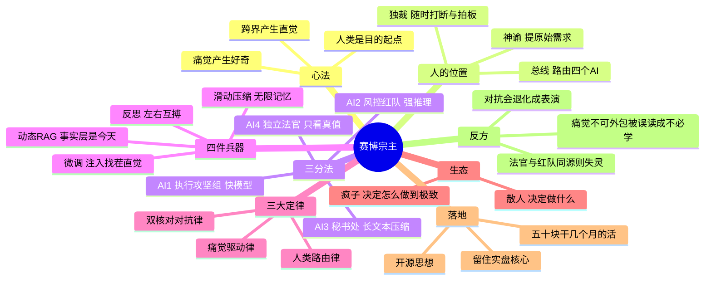

# 赛博宗主：多智能体协同操作手册

> 人类不当零件，人类只当拥有痛觉的「造物主」与「总架构师」。
>
> —— 2026-11-11，手机备忘录（《赛博宗主记忆加载》＋《散人极客：AI时代多智能体协同操作白皮书》）

**一句话**：你不需要成为零件，你只需要掌控图纸。因为你是唯一的「现实重力测试员」，你知道这玩意儿在 A 股到底能不能行得通。

---

## 导图

> 图渲染不出来？看 [思维导图.md](思维导图.md) 的纯文本版。

---

## 一、心法：为什么会有想法（人类内核引擎）

核心答案：**因为你有真实的「痛觉」，而 AI 没有。**

1. **痛觉产生好奇**。你因为做题无聊（痛点），所以去 B 站看 3B1B 的视频；你因为被 AI 瞎编的代码坑了（痛点），所以想出「双 AI 找茬」的方法。
2. **跨界产生直觉**。你把金融的 PBO、硬件的 ESPHome、数学的矩阵空间全装进了脑子；遇到具体问题时，大脑自动完成了「缝合」，这就叫灵感。
3. **人类是目的起点**。AI 所有的算力，都是为了解答你那一瞬间迸发的「如果……会怎样？」。

**意图即实现**：你甚至不需要知道具体痛点是什么，你只需要有一个想法，向 AI 提问「什么是痛点」，然后用你的人类常识去判断。

**核心资产转移**：代码、语法、公式不再值钱。值钱的是「找茬的直觉」「架构图纸」和「元提示词工程」。

---

## 二、人的位置：最高指挥官

在整个流程里，**你绝对不负责敲一行代码**，核心功能只有三个：

1. **提出最原始的需求（神谕）**：你不懂痛点？问 AI「什么是痛点」，再凭常识挑出那个「让你不舒服」的点。
2. **充当核心路由（总线）**：把 AI-1 的结果扔给 AI-2，再把批评扔回 AI-1。信息被切断还是被连接，由你说了算。
3. **随时插入与终结（独裁者）**：看它们陷入死循环时随时打断（「方向错了，去查退市股！」）；结果到及格线时直接拔网线（「行了，发 GitHub。」）。

---

## 三、三分法：四个 AI 的分工

把任务拆成**完全隔离**的「AI 小组」，防止上下文污染，也顺带省算力。

### 3.1 AI-1 执行攻坚组（快模型 / 低算力）

- **角色**：无情的打工人。
- **任务**：按元提示词生成数据、写代码、跑回测。
- **要求**：只给基础需求，**不管风控**。

### 3.2 AI-2 风控红队（强推理模型 / 高算力）

- **角色**：极度刻薄的找茬狂魔。
- **任务**：查未来函数、查幸存者偏差、算 PBO 过拟合。
- **要求**：**绝对不能有讨好型人格**，必须骂出真问题。

### 3.3 AI-3 董事会秘书处（长文本压缩模型）

- **角色**：无情的会议记录员。
- **任务**：把前两组几万字的互相狡辩，压成 200 字的《战报》（通过 / 不通过 / 需要改哪里）。
- **要求**：屏蔽噪音，只提炼核心差异点。

> 战报长这样：
> `结论：不通过。理由三条：①IC 用秩、收益用均值，Q5−Q1 被右尾拉偏；②未剔除退市股，七成收益是生存偏差；③PBO 86%，参数是平手不是最优。下一步：补退市样本、改非重叠 t。`

### 3.4 AI-4 独立法官

- 为防止 AI-3 产生幻觉骗你，开一个**全新的、隔离的** AI。
- 只给它最终代码和硬性指标，**不看任何过程**，只看输出是 `True` 还是 `False`。

> **工程注脚**：法官和红队如果是同一个底座模型、同一段提示词，它们会共享同一种盲区——「独立」不是换个窗口，而是**换证据**（只给数字，不给叙事）。这一点我踩过：让同一个模型自评「有没有过拟合」，它永远说没有。

### 3.5 元提示词（Meta-Prompt）

不要一上来就让它干活。**先让 AI 写出一段完美的「元提示词」**，再用这段提示词去驱动别的 AI。

---

## 四、四件兵器

### 4.1 微调（LoRA）：注入「你的灵魂」

- 普通人问通用模型「A 股怎么买」，得到一堆价值投资的废话。
- 你把 14 节研报、避坑指南、「重叠窗口陷阱」做成数据集，微调一个小模型。
- 结果：它一出场就带着你的找茬直觉。你问策略，它第一句是：「加了滑点吗？PBO 查了吗？」

### 4.2 滑动压缩：塞进无限记忆

- 上下文有限，喂 16 年新闻它吃不下。
- 用滑动窗口 + 文本压缩，把过去 3 个月压成几百字核心摘要（情绪标签、资金流向）再喂。
- 这叫「LSTM 的 LLM 版」：不忘趋势，也不撑爆显存。

### 4.3 动态 RAG：实时接入真实世界

- 训练数据停在 2024 年，去测 2015 年就是时空穿越。
- 每天早 9 点抓当日新闻研报，向量化入本地库（ChromaDB / FAISS），打分前先现搜。
- 知识永远是「今天」的。

> **工程注脚（血泪版）**：动态 RAG 修的是「事实层」，修不了「判断层」。
> RAG 能把今天的新闻喂进去，但模型对「微盘股」「降准」这些词的**先验态度**仍是训练期的。
> 正确用法：**实时用它，历史回测别用**——历史只能上规则编译器，或 cutoff 早于回测日的离线模型。
> 我这周真踩过：把 LLM 情绪接进 2022 回测，IC = −0.011；tilt 从 0 加到 0.5，收益单调从 −5.40% 掉到 −6.06%。

### 4.4 反思（Reflection）：双 AI 左右互搏

- AI-1 生成 → AI-2 找茬 → 结合意见再改 → 自己还能嘲笑自己（「这根本赚不到钱」）。
- 结果：系统不仅会干活，还会自我纠错。

---

## 五、三大定律

### 定律一：痛觉驱动律（Pain-Driven Genesis）

工业时代需求是老板给的，互联网时代是产品经理拍脑袋想的，**AI 时代需求是「人类真实的痛觉」**。AI 没有痛觉，它不知道什么是绝望，所以它想不出真正有价值的痛点。你有多痛，你的想法就有多深。

### 定律二：双核对对抗律（Adversarial Evolution）

永远不要相信单个 AI 的「标准答案」。把 AI 劈成两半：疯狂的生成者（蓝方）与极度刻薄的风控官（红方）。用机器审查机器，用魔法打败魔法。你只负责传递仇恨和挑拨离间——**它们吵得越凶，你得到的代码就越干净**。

### 定律三：人类路由律（The Human Router）

你不需要懂 Python、C++、矩阵。你只需要像超级路由器：「提出想法 → 丢给 AI-1 → 丢给 AI-2 → 随时中断 → 拍板定音 → 发上 GitHub」。**你不需要成为零件，你只需要掌控图纸。**

---

## 六、全流程复盘（真实案例：微盘股反转）

1. **【痛点触发】**：你突然发癫，想知道「微盘股反转能不能赚钱？」（此时你连 Python 都不懂）。
2. **【架构下发】**：打开两个窗口，给 AI-1 下元提示词，让它生成数据清洗和回测代码。
3. **【初次反馈】**：AI-1 交出一份完美的 **0.71 夏普**。
4. **【人类路由】**：你冷笑一声，把结果原封不动打包丢给 AI-2（红方）。
5. **【红队批判】**：「有未来函数，没剔除退市股，PBO 肯定爆表！」
6. **【AI 互殴】**：把骂声扔回 AI-1，它破防修改，甚至自己发现了「时代局限性」的 Bug。
7. **【人类裁决】**：看着被逼出来的「等权组合」和「真实回撤 −26%」，点头：「逻辑没毛病了，把实盘核心代码删了，脱敏，打包。」
8. **【物理落地】**：一键 `git push`，把研报和图表扔上 GitHub；顺手打开酒馆，开始捏下一张音色模型卡。

> 这一趟的实物产出：中证 800 上九个因子全负；同法搬到微盘股，反转显著（J3K3 非重叠 t = −3.07）；补进 110 只退市股后显著性消失（七成是生存偏差）；做成可下单原型，六种参数全部亏损（−7% ~ −19%/年）；最后查清「反转」的本质是**赢家崩塌**（顶 10% 月均 −1.85%），不是**输家反弹**（底 10% 只跑赢全池 0.13 个百分点）。

---

## 七、生态：散人与疯子

- **散人（你）**：懂痛点、懂跨界、懂 AI 编排，负责画图纸、找资源。
- **疯子（底层极客）**：死磕 C++、手搓矩阵推导、修底层 Bug，负责把地基打到地心。
- **共生**：散人决定「做什么」，疯子决定「怎么做才最快最极致」。互相敬畏，不可替代。

---

## 八、落地：开源什么，留一手什么

- **开源**：底层逻辑与思想（诱捕器）——研报、架构图、复现脚本。
- **留一手**：真实盘代码、参数、资金曲线（护城河）。
- **成本降维**：用不到 50 块钱的 API 成本，干完传统实验室几个月的工作量。

---

## 九、反方：这套东西的三个失效点

1. **「痛觉不可外包」很容易被偷换成「我不必学」**。痛觉决定「做什么」，但决定不了「为什么错」。我这周能抓住「重叠窗口放大 t 值」「生存偏差吃掉七成收益」，靠的不是痛觉，是被按着头查了一遍统计口径。
2. **对抗演化会退化成表演**。红方如果只会说「有未来函数」「PBO 爆表」，蓝方三天就学会绕过说辞，而不是真的修。红方必须能给出**可执行的检验**（跑一遍、看数字），不能只给形容词。
3. **法官若与红队同源，整套隔离就失效**。同一个底座模型换个窗口，共享同一套盲区。「独立」要独立在证据上——只喂数字，不喂叙事。

---

## 附录：这一周的实际交付

| 东西 | 数字 |
|---|---|
| 量化引擎 V4.4（16 年回测） | +212.41%、回撤 −25.51%、夏普 0.71 |
| 参数过拟合体检（7 组邻域） | CPCV 89% 路径为正、DSR 95.8%、PBO 86.1% |
| 反转效应复现（研报） | 中证 800 九个因子全负；微盘 J3K3 非重叠 t −3.07 |
| 生存偏差检验 | 补 110 只退市股后 −1.05% → −0.77%，t 全部不显著 |
| 可下单原型 | 六种参数全亏，年化 −7% ~ −19% |
| 每日流水线 | 15:30 模拟盘日报、20:00 政策抓取、周一自检 |

**成本**：这叠东西没花到 50 块钱的 API 费。时间是一周。

---

## 许可

MIT。随便改，改完记得回来骂我。
