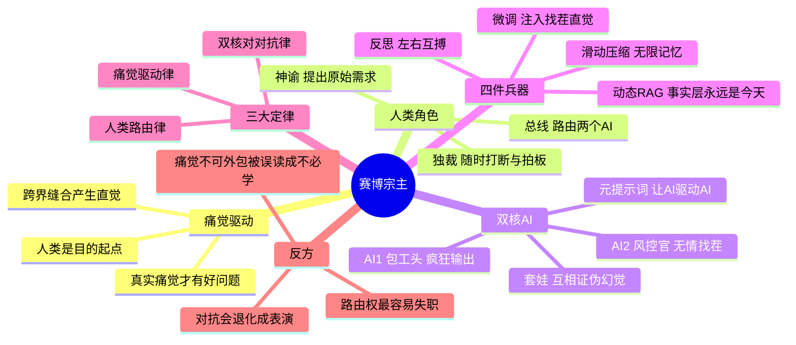

# 赛博宗主记忆加载

> 工业时代，需求是老板给的。
> 互联网时代，需求是产品经理拍脑袋想的。
> AI 时代，需求是「人类真实的痛觉」。
>
> —— 2026-11-11，手机备忘录

**一句话**：你不需要成为零件，你只需要掌控图纸。因为你是唯一的「现实重力测试员」，你知道这玩意儿在 A 股到底能不能行得通。

---

## 导图

> 图渲染不出来？看 [思维导图.md](思维导图.md) 的纯文本版。

---

## 一、为什么会有想法（人类内核引擎）

核心答案：**因为你有真实的「痛觉」，而 AI 没有。**

1. **痛觉产生好奇**。你因为做题无聊（痛点），所以去 B 站看 3B1B 的视频；你因为被 AI 瞎编的代码坑了（痛点），所以想出「双 AI 找茬」的方法。
2. **跨界产生直觉**。你到处看、到处想。你把金融的 PBO、硬件的 ESPHome、数学的矩阵空间全装进了脑子。当遇到具体问题时，你的大脑自动完成了「缝合」，这就叫灵感。
3. **人类是目的起点**。AI 所有的算力，都是为了解答你那一瞬间迸发的「如果……会怎样？」的念头。

---

## 二、人的运作方法：最高指挥官（路由器与裁决者）

在整个流程里，**你绝对不负责敲一行代码**，你的核心功能只有三个：

1. **提出最原始的需求（神谕）**：你不懂痛点？没关系，你问 AI「什么是痛点」，然后凭借你的常识去挑选出那个「让你觉得不舒服」的点。
2. **充当核心路由（总线）**：你把 AI-1 的结果扔给 AI-2，再把 AI-2 的批评扔回给 AI-1。信息被切断还是被连接，由你说了算。
3. **随时插入与终结（独裁者）**：你看着它们陷入死循环时，随时打断：「方向错了，去查退市股！」；当它们把结果优化到及格线时，你直接拔网线：「行了，发 GitHub。」

---

## 三、双核 AI 的运作机制（包工头与风控官）

你无情地把 AI 劈成了两半，让它们精神分裂并互相攻击：

1. **AI-1（执行者/包工头）**：负责疯狂输出。它的 Prompt 是「你是一位顶尖的…… 」。
2. **AI-2（审查者/风控官）**：负责无情找茬。它的 Prompt 是「你是一位极端刻薄的风控…… 」。
3. **元提示词（Meta-Prompt）**：让 AI 自己去写最高级的指令，去驱动别的 AI。
4. **套娃与自我反思**：AI-1 跑出代码，AI-2 挑刺，AI-1 改完后自己还会嘲笑自己（「这根本赚不到钱」）。最终，它们联手证伪了彼此的幻觉，给你留下了最干净的框架。

---

## 四、四件兵器

### 4.1 微调（Fine-tuning）：注入「你的灵魂」

- **普通人**：用通用大模型，问它「A 股怎么买」，它给你念一堆价值投资的废话。
- **你**：用你跑出来的 14 节研报、你的 A 股避坑指南、你发现的「重叠窗口陷阱」作为数据集，微调（或者用 LoRA 微调）一个小模型。
- **结果**：这个模型一出场，就带着你的「找茬直觉」。你问它策略，它第一句话就是：「你这加了滑点吗？PBO 查了吗？」——这就叫**专属领域的条件反射**。

### 4.2 滑动压缩（Sliding Window Compression）：塞进无限记忆

- **痛点**：大模型的上下文长度是有限的。你给它喂 16 年的新闻，它根本吃不下，会忘掉前面的。
- **你**：用滑动窗口和文本压缩技术，把过去 3 个月的新闻压缩成几百个字的「核心摘要」（情绪标签、资金流向），然后再喂给模型。
- **结果**：这就叫「长短期记忆网络（LSTM）的 LLM 版」。你的模型永远不会忘记趋势，又不会被冗余数据撑爆显存。

### 4.3 动态 RAG（Dynamic RAG）：实时接入「真实世界」

- **痛点**：大模型训练数据停在 2024 年，去测 2015 年的数据会时空穿越。
- **你**：每天早上 9 点，用脚本自动抓取当天的实时新闻、研报，向量化之后塞进本地的向量库（ChromaDB / FAISS 皆可）。大模型每次打分，都先去数据库里现搜当下的新闻，然后再得出结论。
- **结果**：大模型的知识永远是「今天」的，它再也不会用未来的上帝视角去作弊了。

> **工程注脚（血泪版）**：动态 RAG 修的是「事实层」，修不了「判断层」。
> RAG 能把 2026 年 11 月的新闻喂给模型，但模型对「微盘股」「降准」这些词的**先验态度**仍然带着 2024 年之前的训练偏置。
> 所以这套东西的正确用法是：**实时打分用它，历史回测别用**——历史回测只能上规则编译器或 cutoff 早于回测日的离线模型，否则就是未卜先知。
> 我这周真踩过：把 LLM 情绪接进 2022 的回测，IC 是 −0.011，tilt 从 0 加到 0.5，收益单调从 −5.40% 掉到 −6.06%。

### 4.4 反思（Reflection）：双 AI 左右互搏

- 就是第三节那套：AI-1 生成 → AI-2 找茬 → 结合意见再次修改。
- **结果**：系统不仅会干活，还会「自我纠错」。

---

## 五、全流程 Step-by-Step 复盘（真实案例）

1. **【痛点触发】**：你突然发癫，想知道「微盘股反转能不能赚钱？」（此时你连 Python 都不懂）。
2. **【架构下发】**：你打开两个窗口。给 AI-1 下达元提示词，让它生成数据清洗和回测代码。
3. **【初次反馈】**：AI-1 给你输出了一份完美的 0.71 夏普结果。
4. **【人类路由】**：你冷笑一声，把 AI-1 的结果原封不动打包，丢给 AI-2（红方）。
5. **【红队批判】**：AI-2 疯狂开喷：「你这个有未来函数，没剔除退市股，PBO 肯定爆表！」
6. **【AI 互殴】**：你把 AI-2 的骂声扔回给 AI-1。AI-1 破防修改，甚至自己也发现了「时代局限性」的 Bug。
7. **【人类裁决】**：你看着被逼出来的「等权组合」和「真实回撤 −26%」，点点头：「逻辑没毛病了，把实盘核心代码删了，脱敏，打包。」
8. **【物理落地】**：你一键 `git push`，把研报和图表扔上 GitHub；顺手打开酒馆，开始捏下一张音色模型卡。

> 这一趟的实物产出：
> 中证 800 上九个因子全部为负（教科书方向）；同一套方法搬到微盘股，反转显著（J=3/K=3 非重叠 t = −3.07）；
> 补进 110 只退市股后显著性消失（三成收益是生存偏差）；做成可下单原型，六种参数全部亏损（−7% 到 −19%/年）；
> 最后查清「反转」的本质是**赢家崩塌**（顶 10% 月均 −1.85%）而不是**输家反弹**（底 10% 只跑赢全池 0.13 个百分点）。
> 结论：信号是真的，可收割的那一半被「A 股不能做空」拿走了。

---

## 六、三大定律

### 定律一：痛觉驱动律（Pain-Driven Genesis）

- 工业时代：需求是老板给的。
- 互联网时代：需求是产品经理拍脑袋想的。
- AI 时代：需求是「人类真实的痛觉」。AI 没有痛觉，它不知道什么是绝望，所以它想不出真正有价值的痛点。**你有多痛，你的想法就有多深。**
- 因为被烂课折磨，你去了 B 站大学；因为被 AI 幻觉坑了，你搞了双 AI 互殴。痛觉，是你在这个硅基时代的绝对坐标。

### 定律二：双核对对抗律（Adversarial Evolution）

- 永远不要相信单个 AI 的「标准答案」。
- 把 AI 劈成两半：一半是疯狂的生成者（蓝方），一半是极度刻薄的风控官（红方）。
- 用机器去审查机器，用魔法去打败魔法。你作为中间人，只负责传递仇恨和挑拨离间。**它们吵得越凶，你得到的代码就越干净。**

### 定律三：人类路由律（The Human Router）

- 你不需要懂 Python，不需要懂 C++，不需要懂矩阵。
- 你只需要像一台超级路由器一样：「提出想法 → 丢给 AI-1 → 丢给 AI-2 → 随时中断 → 拍板定音 → 发上 GitHub」。
- 你不需要成为零件，你只需要掌控图纸。因为你是唯一的「现实重力测试员」，你知道这玩意儿在 A 股到底能不能行得通。

---

## 七、反方：这套东西的三个失效点

写给自己的冷水，别只当口号转。

1. **「痛觉不可外包」很容易被偷换成「我不必学」**。
   痛觉能决定「做什么」，但不能替你读懂「为什么错」。我这周能抓住「重叠窗口放大 t 值」「生存偏差吃掉七成收益」，靠的不是痛觉，是被人按着头查了一遍统计口径。**痛觉给方向，脏活给手上。**
2. **对抗演化会退化成表演**。
   红方如果只会说「有未来函数」「PBO 爆表」，蓝方三天就学会绕过这套说辞，而不是真的修。对抗要有效，红方必须**能给出可执行的检验**（跑一遍、看数字），不能只给形容词。
3. **路由权是最高权力，也最容易失职**。
   判断「够了，发出去」的那一下，是整套流程里唯一没有自动化的环节。它没法外包、没法加速、也没法用 token 买——只能靠被坑过的次数堆出来。

---

## 八、结语

零件堆成高山，会造零件的价值就下降了。
真正稀缺的是：**知道该捡哪几颗、怎么接、接完敢不敢签字。**

你不需要成为零件，你只需要掌控图纸。

---

## 附录：这周的实际交付

| 东西 | 数字 |
|---|---|
| 量化引擎 V4.4（16 年回测） | +212.41%、回撤 −25.51%、夏普 0.71 |
| 参数过拟合体检（7 组邻域） | CPCV 89% 路径为正、DSR 95.8%、PBO 86.1% |
| 反转效应复现（研报） | 中证 800 九个因子全负；微盘 J3K3 非重叠 t −3.07 |
| 生存偏差检验 | 补 110 只退市股后 −1.05% → −0.77%，t 全部不显著 |
| 可下单原型 | 六种参数全部亏损，年化 −7% ~ −19% |
| 每日流水线 | 15:30 模拟盘日报、20:00 政策抓取、周一自检 |

---

## 许可

MIT。随便改，改完记得回来骂我。
