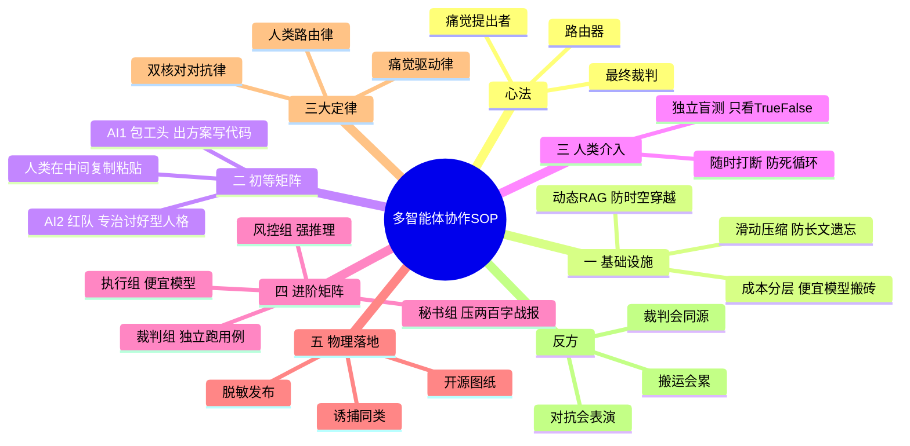

# 🚀 多智能体协作 SOP（标准作业程序）

> 核心心法：人类不当底层搬砖工，人类只做「痛点提出者」「路由器」和「最终裁判」。

---

## 导图



> 图渲染不出来？看 [思维导图.md](思维导图.md) 的纯文本版。

---

## 🛠️ 第一阶段：基础设施与防坑搭建

1. **解决「时代局限性」（动态 RAG）**：大模型知识是静止的。建立本地数据库，实时抓取行业最新数据 / 新闻 / 设定，强行喂给 AI，防止它产生「时空穿越」的幻觉。
2. **解决「长文本遗忘」（滑动压缩）**：上下文太长 AI 会变傻。对超长文本进行切片和摘要压缩，保持输入纯净。
3. **API 成本控制**：脏活、累活、写代码，用最便宜、速度快的模型（如 DeepSeek Flash）；核心审查、逻辑推理，用最聪明但贵的模型。**绝不拿大炮轰蚊子。**

> 注（血泪版）：动态 RAG 修的是「事实层」，修不了「判断层」。RAG 能把今天的新闻喂进去，但模型对「微盘股」「降准」这些词的先验态度仍是训练期的。
> 所以：**实时打分用它，历史回测别用**——历史只能上规则编译器，或 cutoff 早于回测日的离线模型。
> 实测：把 LLM 情绪接进 2022 回测，IC = −0.011；tilt 从 0 加到 0.5，收益单调从 −5.40% 掉到 −6.06%。

---

## 🔄 第二阶段：初等矩阵（双 AI 互殴模式）

不要用一个 AI 包揽所有活，要让它精神分裂：

- **AI-1（执行组 / 包工头）**：只负责写代码、出方案。Prompt 设定：「你是一个顶尖的 XX 工程师」。
- **AI-2（风控组 / 红队）**：专治 AI 的讨好型人格。Prompt 设定：「你是一个极度刻薄、绝不妥协的找茬专家」。
- **操作流**：AI-1 出结果 ➔ 人类复制 ➔ 喂给 AI-2 找茬 ➔ 人类复制 AI-2 的批评 ➔ 喂回 AI-1 修改。

**硬件**：两个浏览器标签页，加一双搬消息的手。没有 API，没有框架。

---

## 👑 第三阶段：人类介入（人类路由与裁决）

在整个流程中，人类必须死死把控这两个绝对权力：

1. **随时打断（防死循环）**：如果 AI-1 和 AI-2 开始车轱辘话来回说，人类立刻拔网线，强行输入新的指令干预方向。
2. **最终拍板（独立盲测）**：当 AI 互殴出最终代码时，开一个全新的 AI-3（只看对错、不听废话的裁判组），给它最终的测试用例。输出 `True` 就发版，输出 `False` 就推翻重来。

> 注：「独立」不是换个标签页，是**换证据**——裁判只拿到最终产物和硬指标，不看过程、不看解释。同一个底座模型换个窗口，共享同一套盲区。

---

## 🏢 第四阶段：进阶扩展（多智能体矩阵）

当双 AI 互殴变得太累、太耗 Token 时，将工作流拆分为四个隔离的「小组」（防止上下文污染）：

| 组 | 用什么模型 | 干什么 |
|---|---|---|
| 执行组 | 便宜模型 | 不带历史记录，只按指令搬砖 |
| 风控组 | 强推理模型 | 只审查代码、挑毛病 |
| 秘书组 | 长文本模型 | 把前两组几万字的对骂，压成**两百字核心战报**，减轻人类阅读负担 |
| 裁判组 | 独立 AI | 不看过程，只跑自动化测试用例，输出真假 |

### 角色卡：随时更换

蓝队和红队不是两个「人」，是**两张可以随时更换的角色卡**——换卡就换岗，流程不动。

| 卡 | 岗位 | 手里握的是什么 |
|---|---|---|
| 蓝-A | 建模手 | 需求 + 数据字典 → 可运行的模型/代码 |
| 蓝-B | 写手 | 结论 + 读者 → 研报、README、提案 |
| 红-A | 量化评审 | 代码 + 回测结果 → 问题清单（每条带复现方式） |
| 红-B | 产品评审 | 方案 + 用户 → 风险与边界清单 |
| 秘书 | 会议记录员 | 几万字对话 → 200 字战报 |
| 裁判 | 独立裁判 | 最终产物 + 硬指标 → True / False |

**换卡时机**：任务类型变了就换，不是模型变了才换。写代码用「建模手 + 量化评审」，写文章用「写手 + 产品评审」。

**每张卡必须写清四件事**：输入是什么、输出长什么样、禁止什么、做到什么程度算通过。

<details>
<summary>四张示例卡（可直接抄）</summary>

```text
【卡·蓝-A 建模手】
输入：需求描述、数据字段表、目标评估指标。
产出：单文件可运行代码；自带 --selftest；打印关键中间量。
禁止：承诺收益；隐藏假设；用"大概""应该"代替数字。
通过标准：能一键跑通，且中间量能被第三方复算。

【卡·红-A 量化评审】
输入：被审代码、回测报告、数据口径说明。
产出：问题清单，每条含「问题 / 证据 / 复现命令 / 修复建议」。
禁止：形容词（"感觉不可靠"）；只说结论不给复现方式；讨好。
通过标准：至少找出一个可量化的问题，或明确写"本轮未发现，检查项如下：…"。

【卡·秘书】
输入：蓝队与红队的完整对话。
产出：≤200 字战报，固定三段：结论（通过/不通过）/ 关键证据（带数字）/ 下一步（谁做什么）。
禁止：复述过程；保留客套话；给出没有证据的倾向。
通过标准：人类读完这 200 字就能拍板。

【卡·裁判】
输入：最终产物 + 一组预先约定的硬指标（不看对话、不看叙述）。
产出：True / False，加一行依据（命中了哪条指标）。
禁止：读取过程记录；被解释说服；自行修改阈值。
通过标准：换一个人重跑同样的指标，得到同样的 True/False。
```

</details>

**战报样例**（秘书组产出）：

> `结论：不通过。理由三条：①IC 用秩、收益用均值，Q5−Q1 被右尾拉偏；②未剔除退市股，七成收益是生存偏差；③PBO 86%，参数是平手不是最优。下一步：补退市样本、改非重叠 t。`

---

## 📦 第五阶段：物理落地与开源

1. **脱敏发布**：把跑通的成果发布到 GitHub，但必须删除核心业务参数、核心提示词和实盘接口。
2. **开源图纸**：公开你的架构图、SOP 流程、大白话说明书。用「诱捕器」筛选同类，寻找能死磕底层的「疯子」做合伙人。

---

## 三大定律

### 定律一：痛觉驱动律（Pain-Driven Genesis）

工业时代需求是老板给的，互联网时代是产品经理拍脑袋想的，**AI 时代需求是「人类真实的痛觉」**。AI 没有痛觉，它不知道什么是绝望，所以它想不出真正有价值的痛点。你有多痛，你的想法就有多深。

### 定律二：双核对对抗律（Adversarial Evolution）

永远不要相信单个 AI 的「标准答案」。把 AI 劈成两半：疯狂的生成者（蓝方）与极度刻薄的风控官（红方）。用机器审查机器，用魔法打败魔法。你只负责传递仇恨和挑拨离间——**它们吵得越凶，你得到的代码就越干净**。

### 定律三：人类路由律（The Human Router）

你不需要懂 Python、C++、矩阵。你只需要像超级路由器：「提出想法 → 丢给 AI-1 → 丢给 AI-2 → 随时中断 → 拍板定音 → 发上 GitHub」。**你不需要成为零件，你只需要掌控图纸。**

---

## 真实案例：微盘股反转（八步复盘）

1. **【痛点触发】**：想知道「微盘股反转能不能赚钱？」（此时连 Python 都不懂）。
2. **【架构下发】**：开两个窗口，给 AI-1 下元提示词，让它生成数据清洗和回测代码。
3. **【初次反馈】**：AI-1 交出一份完美的 **0.71 夏普**。
4. **【人类路由】**：冷笑一声，把结果原封不动打包丢给 AI-2（红方）。
5. **【红队批判】**：「有未来函数，没剔除退市股，PBO 肯定爆表！」
6. **【AI 互殴】**：把骂声扔回 AI-1，它破防修改，甚至自己发现了「时代局限性」的 Bug。
7. **【人类裁决】**：看着被逼出来的「等权组合」和「真实回撤 −26%」，点头：「逻辑没毛病了，把实盘核心代码删了，脱敏，打包。」
8. **【物理落地】**：一键 `git push`，把研报和图表扔上 GitHub。

> 产出：中证 800 上九个因子全负；同法搬到微盘股反转显著（J3K3 非重叠 t = −3.07）；补进 110 只退市股后显著性消失（七成是生存偏差）；做成可下单原型，六种参数全部亏损（−7% ~ −19%/年）；最后查清「反转」的本质是**赢家崩塌**（顶 10% 月均 −1.85%），不是**输家反弹**（底 10% 只跑赢全池 0.13 个百分点）。

---

## 反方：这套 SOP 的三个失效点

1. **搬运会先累死人**。开到第十轮，你会开始替 AI 总结——把三条批评压成一条，然后漏掉最关键的那条。对策很土：只搬「结论 + 证据 + 下一步」，让卡强制结构化输出。
2. **对抗会退化成表演**。红方如果只会说「有未来函数」「PBO 爆表」，蓝方三天就学会绕过说辞。红方必须给出**可执行的检验**（跑一遍、看数字），否则就是文体表演。
3. **裁判若与红队同源，隔离失效**。同一个底座换个窗口，共享同一套盲区。独立要独立在证据上：只喂数字，不喂叙事。

> 补充：卡改版必须记 v1/v2。红队卡从「找问题」加一条「必须给复现命令」之后，通过率从 71% 掉到 38%——看着像质量崩了，其实是尺子换了。

---

## 附录：这一周的实际交付

| 东西 | 数字 |
|---|---|
| 量化引擎 V4.4（16 年回测） | +212.41%、回撤 −25.51%、夏普 0.71 |
| 参数过拟合体检（7 组邻域） | CPCV 89% 路径为正、DSR 95.8%、PBO 86.1% |
| 反转效应复现（研报） | 中证 800 九个因子全负；微盘 J3K3 非重叠 t −3.07 |
| 生存偏差检验 | 补 110 只退市股后 −1.05% → −0.77%，t 全部不显著 |
| 可下单原型 | 六种参数全亏，年化 −7% ~ −19% |
| 每日流水线 | 15:30 模拟盘日报、20:00 政策抓取、周一自检 |

**成本**：这叠东西没花到 50 块钱的 API 费。时间是一周。

---

## 许可

MIT。随便改，改完记得回来骂我。
