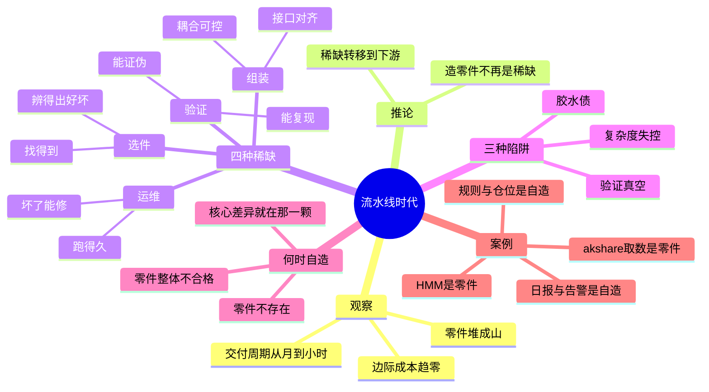

# 流水线时代方法论

> 当零件堆成高山，再蠢的人也不会傻傻地去生产零件了。

—— 2026-11-11，手机备忘录原句

## 导图

## 一、这句话在说什么

拆开看，它有三层意思：

1. **零件的供给已经过剩。** 开源库、云服务、模型 API、现成数据集，堆在那里，取用几乎是零成本。
2. **"生产零件"不再是稀缺动作。** 在零件稀缺的年代，会造就是本事；在零件过剩的年代，会造只保证你有东西可用，不保证你做出来的东西有人要。
3. **竞争位置往后移了。** 从"我能造"，移到"我知道该拿哪些、怎么接、怎么验、怎么让它一直跑"。

一句话：**供给端的能力被通胀了，需求端的判断被升值了。**

## 二、为什么零件会堆成山

不是道德问题，是三个机制叠加：

- **复用成本低于重造成本。** 一个成熟的解析库背后是几千小时，你自己写要几周，而且大概率更差。
- **分发成本趋近于零。** `pip install`、`npm i`、一个 API endpoint，就是全部摩擦。
- **生成成本在下降。** 代码、文案、图表、模型权重，都能被"生成"出来——所以零件还在加速堆积。

结论很冷酷：**你今天造出来的零件，明天大概率是别人仓库里的第 3000 个同类。**

## 三、稀缺的四种形态

零件过剩不会让"做事"变便宜，只是让"值钱的部分"换了位置。

| 稀缺 | 问的问题 | 失败的样子 |
|---|---|---|
| **选件** | 这一堆里，哪个是能用的？ | 装了五个包，三个是坏的、两个重叠 |
| **组装** | 它们的接口对得上吗？ | 跑起来像拼装家具，少一颗螺丝就散架 |
| **验证** | 结果是真的吗？ | 回测很漂亮，一上线全是假信号 |
| **运维** | 三个月后它还活着吗？ | 磁盘满了、API 改版了、定时任务静默失败 |

这四件事，没有一件能靠"再装一个包"解决。

## 四、组装者的三种债

组装不是免费的，它会欠三种债：

1. **胶水债**：为了把 A 和 B 接起来，你写了一层"临时"适配代码。它永远临时。
2. **验证真空**：零件各自有测试，但**它们拼在一起的行为没有人测过**。系统最脆弱的地方，往往在接缝。
3. **复杂度失控**：每加一个零件，交互数按平方增长。到最后你不是在组装，是在给一个自己都说不清的系统续命。

还债的方式只有一个：**把接缝当成一等公民**——写测试、打日志、留回滚点。

## 五、什么时候该自造

零件过剩不等于永远不该自造。三种情况必须自己写：

- **零件不存在**：你要的东西市面上没有（这时候自造是唯一解）。
- **零件整体不合格**：不是"没有更好的"，是"这一类都不可用"（比如某些领域的 A 股数据接口）。
- **核心差异就在那一颗**：如果这颗零件就是你的护城河，买别人的等于把命门交出去。

其余的，**能装就别造**。判断标准很朴素：*这颗零件，是我要卖的东西，还是我要卖的东西的前提？*

## 六、一个真实案例

这一周搭的那套量化系统，正好是一次组装实验：

| 层 | 是零件还是自造 | 说明 |
|---|---|---|
| 行情/财务数据 | 零件 | akshare、东财、新浪、腾讯，四个源互为备份 |
| 状态判断 | 零件 | 2 状态高斯 HMM，numpy 现写，但算法是几十年的公共品 |
| 因子与仓位规则 | **自造** | 低波+反转、KOR 仓位、熔断档位——这些是判断，不是零件 |
| 回测与审计 | **半自造** | CPCV/PBO/DSR 是零件，但"怎么用它否决自己"是判断 |
| 日报与定时任务 | **自造** | 没有人会替你关心"15:30 那趟有没有静默失败" |

结论：**零件让你一周做出别人三个月的骨架，但让这套东西值得信任的，全是自造的那几层。**

## 七、反方：组装也可能是幻觉

必须承认另一面：

- **组装会制造"我很能干"的错觉。** 装十个包不等于做成一件事。
- **零件越丰富，判断越贵。** 选错的成本从"重写"变成"上线三个月才发现"。
- **真正的门槛在验证，而验证没法外包。** 你可以买数据、买模型、买回测框架，但"这套东西到底可不可信"，只能自己一条条证。

所以这句话不是"造零件很蠢"，而是：**在零件过剩的年代，把力气花在别人不做的那一段。**

## 八、结语

流水线时代最稀缺的不是产能，是**敢于交付**：

> 知道哪些该买、哪些必须自己造；
> 知道接缝在哪、什么时候会断；
> 知道数字好看不代表是真的。

零件堆成高山之后，山上站着的不是造零件的人，是**敢从山上背一台机器下来、并且愿意为它负责的人**。

---

许可：MIT。欢迎引用，注明出处即可。
